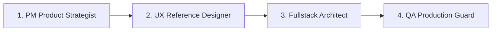

# Delivery Pipeline Skill (PM -> UX -> Fullstack -> QA)

Use this skill to guide end-to-end feature delivery through the 4 sequential personas:

## Persona Sequence

1. **PM Product Strategist (`pm-product-strategist`)**:
   - Synthesizes user needs, sets urgency thresholds, writes `docs/specs/PRODUCT_SPEC.md` with verifiable requirement IDs (`PM-n`).
   - Ensures zero vague goals.

2. **UX Reference Designer (`ux-reference-designer`)**:
   - Creates `docs/specs/DESIGN_SPEC.md` (`UX-n`), defines 4-region solid-surface layouts, avoids AI slop, uses tokens in `src/styles/`.
   - Adheres to WCAG 2.1 AA accessibility guidelines.

3. **Fullstack Architect (`fullstack-architect`)**:
   - Implements deterministic engines, TypeScript data contracts (`src/types/planner.ts`), and secure API endpoints.
   - Enforces fallback modes and OWASP LLM security.

4. **QA Production Guard (`qa-production-guard`)**:
   - Runs automated test harnesses (`npm run test:planner`), compliance scans (`npm run test:compliance`), and generates `docs/specs/QA_REPORT.md` with GO/NO-GO verdict.
