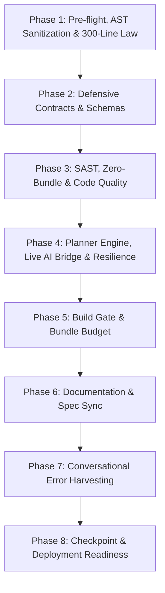

# Master Sync Skill (8-Phase Orchestration Protocol)

This skill is the top-level orchestrator for synchronizing, validating, and securing the **UtsavAI Celebration & Event Planner** codebase for Prompt Wars Challenge 5 and gold-standard template for Challenge 6+.

Execute all 8 phases in strict sequential order. Do NOT skip gates.

---

## Phase 1: Pre-Flight, AST Sanitization & 300-Line Law
1. **The 300-Line File Ceiling**: Scan all `.ts` and `.tsx` files in `src/` and `server.ts`. Every logic and component file MUST be `<= 300` lines (excluding data dictionaries `i18n.ts` and `presets.ts`). Decompose God Objects into subcomponents and hooks.
2. **Zero Committed Bundles Gate**: Verify that `api/` contains only native TypeScript `api/index.ts`. No compiled `.js` bundle (e.g., `api/index.js` or `dist/`) may be tracked in Git.
3. **Repository Sanitation**: Scan root and `src/` for orphaned scratch files, temporary logs, or mock data blobs that risk breaching the 10 MB repo cap.
4. **Circular Dependency Verification**: Execute `runCircularDepScan()` to ensure zero circular dependencies across client and server modules.
5. **Dead Code Elimination**: Review exports and unused types. Never delete deterministic calculation functions in `src/lib/plannerEngine.ts` or tests without explicit user confirmation.

## Phase 2: Defensive Contracts & Schema Integrity
1. **Schema vs TypeScript Synchronization**: Run `runContractDriftScan()` to verify that `docs/specs/contract.schema.json` and `docs/specs/response.schema.json` match `src/types/planner.ts` 1:1 with zero drift.
2. **Fail-Fast Input Validation**: Verify that `/api/rebalance` and `/api/audit-vendor` enforce strict JSON schema validation and return HTTP 400 (`ValidationError`) on malformed payloads.

## Phase 3: SAST, Secret Scanning & Code Quality Hygiene
1. **Zero Type Shortcuts & Empty Catch Blocks**: Assert 0 occurrences across `src/` and `server.ts` of `: any`, `as any`, `@ts-ignore`, and empty `catch {}` blocks.
2. **Dependency Audit**: Run `npm audit` and assert zero known vulnerabilities (`found 0 vulnerabilities`).
3. **Static Application Security Testing (SAST)**:
   - Verify zero occurrences of `dangerouslySetInnerHTML` in UI components (must use `SafeNarrative.tsx`).
   - Verify zero hardcoded API keys or credentials in source code.
   - Assert all HTTP security headers (`Content-Security-Policy`, `nosniff`, `DENY`, `strict-origin-when-cross-origin`) are enforced in `server.ts`.
4. **Zero-PII Storage Leakage**: Run `runZeroPiiScan()` to guarantee zero usage of `localStorage`, `sessionStorage`, `indexedDB`, or `document.cookie`.

## Phase 4: Planner Test Suite, Live AI Bridge & Human-Centric UI
1. **Automated Planner Test Harness**: Run `npm run test:planner`.
2. **Assertion Gate**: All 14/14 planner resilience scenarios MUST pass (100% pass rate):
   - `RES-1`: Exact Budget Summation & Zero Variance Baseline (`ON_TRACK`).
   - `RES-2`: 20% Budget Overrun Detection & Deficit Flagging (`CRITICAL_OVERRUN`).
   - `RES-3`: Mid-Flight Guest Count Surge (+50 Guests) Linear Catering Scaling.
   - `RES-4`: Fixed Venue & Photography Invariance Under Guest Count Changes.
   - `RES-5`: Mid-Flight Date Pull-In (-14 Days) Critical Path Bottleneck Detection (`TIMELINE_BOTTLENECK`).
   - `RES-6`: Topological Sort of Milestone Dependencies (Venue Lock -> Catering -> Invites).
   - `RES-7`: Cyclic Dependency Guard & Graceful DAG Recovery.
   - `RES-8`: Unverified Vendor Quote Clause Detection (Missing GST, Generator, Cleaning Fees).
   - `RES-9`: Estimate vs. Confirmed Quote Provenance Tracking.
   - `RES-10`: Offline / Missing `GEMINI_API_KEY` Deterministic Trade-Off Fallback (`<10ms`).
   - `RES-11`: Rate-Limit (HTTP 429) Circuit Breaker & Graceful UI Banner Fallback.
   - `RES-12`: RFC 5545 `.ics` Calendar Export Payload Conformance.
   - `RES-13`: WhatsApp (`wa.me`) Encoded Negotiation URL Sanitization.
   - `RES-14`: 100-Event Synthetic Stress Benchmark Execution (`<50ms`).
3. **Live AI Bridge Gate**: Verify that `src/` contains active `fetch('/api/...')` calls to the backend endpoints for qualitative rebalancing and vendor quote auditing.
4. **Human-Centric Domain Copy Gate**: Verify user-facing UI labels contain zero raw spec jargon (e.g. `ADR-1`, `Kahn's DAG`, `OWASP LLM01`).

## Phase 5: Build Gate, Repo Size & Bundle Performance Budget
1. **TypeScript Typecheck**: Run `npm run lint` (`tsc --noEmit`) to verify 0 type errors.
2. **Production Bundle Compilation**: Run `npm run build` via Vite.
3. **Gzip & Repo Footprint Budget**: Execute `runBundleBudgetScan()`:
   - Primary JS bundle: `< 150 kB` gzip.
   - Primary CSS bundle: `< 20 kB` gzip.
   - Total Git repository size: `< 10 MB` (`git count-objects -vH`).

## Phase 6: Documentation & Spec Synchronization
Synchronize all repository documentation and specifications:
- `docs/specs/PRODUCT_SPEC.md` (`PM-n` traceability).
- `docs/specs/DESIGN_SPEC.md` (`UX-n` design system tokens).
- `docs/specs/03_SECURITY.md` (Zero-Auth, Secret Hygiene, Network Boundary PII Guards).
- `docs/specs/DECISIONS.md` (ADR-1 through ADR-6).
- `docs/specs/QA_REPORT.md` (Conformance table, compliance scans, GO/NO-GO verdict).
- `README.md`, `ARCHITECTURE.md`, `LLM_AND_SECURITY.md`, & `HANDOVER.md`.
- Ensure Gemini model names (`gemini-3.5-flash`, `gemini-3.5-flash-lite`) and deployment URLs match 1:1.

## Phase 7: Conversational Error Harvesting & Rule Hardening
1. Review the conversation trajectory and test logs for any edge cases, validation failures, or lint issues encountered during development.
2. Formulate explicit regression tests or type guards to prevent recurrence.
3. Harden the test harness (`scripts/testHarness.ts`) with new negative test assertions.

## Phase 8: Safe Checkpoint & Deployment Readiness
1. **Zero-PII OPSEC Sanitization**: Confirm no personal data, machine-specific paths, or API keys leaked into commit diffs or temporary artifacts.
2. **Single-Branch Verification**: Confirm `git branch -a` shows strictly `main`.
3. **Deployment Port Compliance**: Confirm server listens on port 3000 (`process.env.APP_PORT || 3000`).
4. Report final pipeline synchronization verdict to the user.
