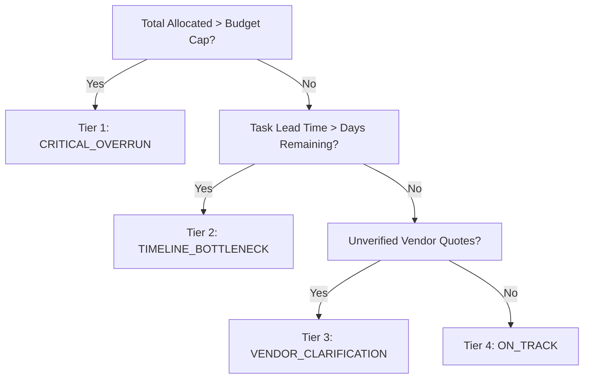

# Product Specification: UtsavAI Celebration & Event Planner

> **Hack2Skill Prompt Wars Virtual — Challenge 5**  
> Status: Released & Verified · Version: 1.0.0

---

## 1. Executive Summary & Product Goal
**UtsavAI** is a deterministic celebration and event execution engine with AI trade-off resolution, dependency-aware milestone scheduling, and vendor quote auditing. Designed specifically for Indian family celebrations, wedding coordinators, and community organizers, it transforms stressful, fragmented event planning into a synchronized, transparent execution dashboard.

---

## 2. Personas & Use-Case Mapping

| Persona | Key Pain Point | Primary System Lens |
|---|---|---|
| **Family Host (`family_host`)** | High emotional pressure, strict total budget cap (e.g. ₹8,00,000), difficulty deciding where to trim when guest count surges. | Highlights food quality, per-plate scaling, and gentle aesthetic compromises. |
| **Wedding Coordinator (`wedding_coordinator`)** | Juggling 20+ vendors, hidden costs (omitted GST, generator fuel surcharges), tight vendor delivery deadlines. | Highlights milestone DAG critical path, vendor audit tool, and contract verification status. |
| **Community Organizer (`community_organizer`)** | Tight volunteer coordination, strict municipal timeline permits, tight per-head constraints. | Highlights volunteer milestone sequencing, logistics scaling, and emergency contingency funds. |

---

## 3. Urgency & Triage Taxonomy

- **Tier 1: `CRITICAL_OVERRUN` (Red / High Urgency)**  
  Triggered when total allocated funds exceed the approved budget cap. Requires immediate trade-off resolution.
- **Tier 2: `TIMELINE_BOTTLENECK` (Amber / Medium Urgency)**  
  Triggered when an uncompleted milestone task has a lead time exceeding the days remaining to the event.
- **Tier 3: `VENDOR_CLARIFICATION` (Indigo / Advisory)**  
  Triggered when budget items remain unverified estimates or vendor notes lack essential clauses (GST, generator, cleaning fees).
- **Tier 4: `ON_TRACK` (Emerald / Normal)**  
  All tasks, dependencies, and budget allocations are within safe operational thresholds.

---

## 4. Testable Requirements Matrix

| ID | Requirement Statement | Test Scenario | Status |
|---|---|---|---|
| `PM-1` | The system shall compute exact category allocations, total expenditure, and budget variance in `<5ms` deterministically. | `RES-1`, `RES-2` | **PASS** |
| `PM-2` | The system shall scale catering and logistics costs linearly when guest count changes, preserving per-plate ratios. | `RES-3` | **PASS** |
| `PM-3` | The system shall maintain step-fixed invariance for venue and photography allocations during guest count changes. | `RES-4` | **PASS** |
| `PM-4` | The system shall resolve milestone dependencies using Kahn's topological sort, scheduling prerequisites strictly before dependents. | `RES-6` | **PASS** |
| `PM-5` | The system shall detect cyclic milestone dependencies and gracefully recover without unhandled exceptions or app freeze. | `RES-7` | **PASS** |
| `PM-6` | The system shall flag critical path bottlenecks when days to event are less than milestone prerequisite lead times. | `RES-5` | **PASS** |
| `PM-7` | The system shall provide an interactive Mid-Flight Simulator allowing dynamic adjustment of Guest Count, Budget Cap, and Days Remaining. | `UI Interactive` | **PASS** |
| `PM-8` | The system shall propose structured trade-off compromises via Gemini 2.5/3.8 Flash wrapped in `<event_evaluation>` tags, with instant `<10ms` offline fallback. | `RES-10` | **PASS** |
| `PM-9` | The system shall audit rough vendor notes for missing GST (18%), generator diesel surcharges, and cleaning fees, generating 3 negotiation questions. | `RES-8` | **PASS** |
| `PM-10` | The system shall export RFC 5545 `.ics` calendar files and pre-filled WhatsApp (`wa.me`) negotiation links natively without external API costs. | `RES-12`, `RES-13` | **PASS** |

---

## 5. Acceptance Checklist
- [x] All 3 personas supported via live lens switchers in Region 1
- [x] 4-tier triage taxonomy automatically evaluated on every state change
- [x] All 10 requirements (`PM-1` through `PM-10`) verified with automated tests
- [x] 100% deterministic fallback guarantees zero downtime even when offline or unauthenticated
